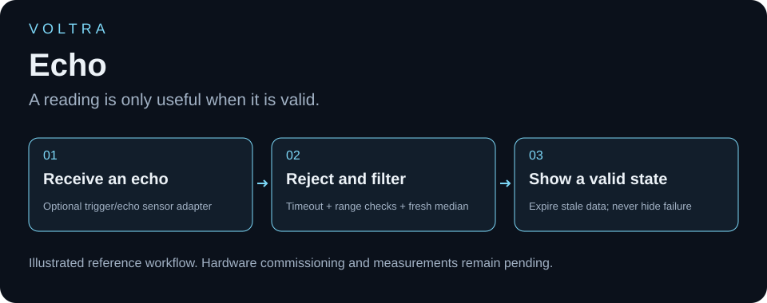
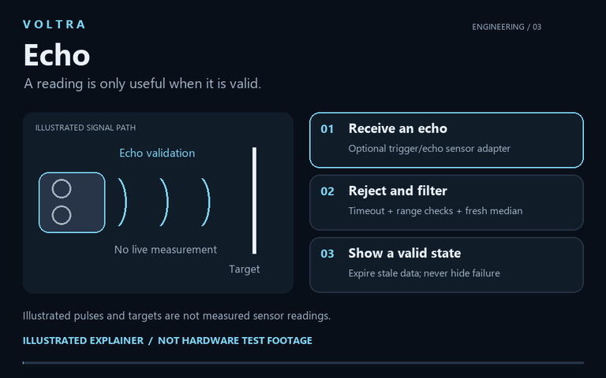
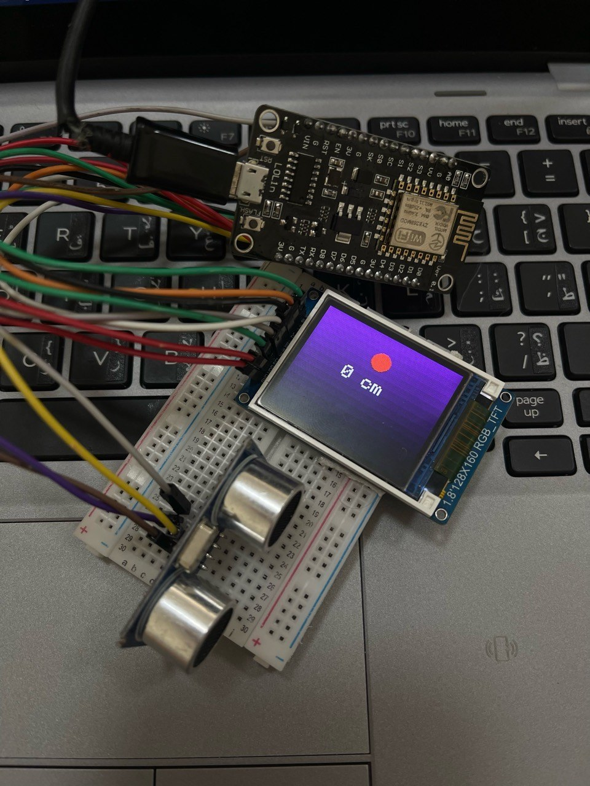
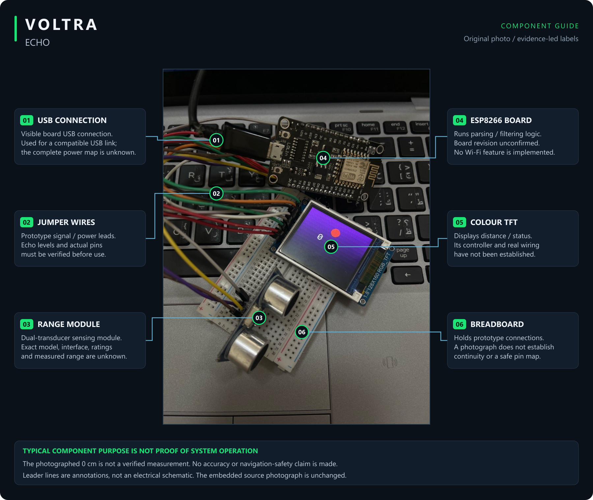

<h1 align="center">VOLTRA</h1>
<h2 align="center">Echo</h2>

<a href="docs/ENGINEERING_GUIDE.md">Understand the build</a> · <a href="docs/DEMO_TEST_PLAN.md">Plan a real demo</a> · <a href="tests/hardware-observations.csv">Record observations</a>

### From the physical world to a readable number.

## See the idea in motion

[Watch or download the 12-second explainer](media/walkthrough.mp4). A silent illustration of echo validation, filtering and display state—not live sensor footage or measured distance. The physical sensor and display adapters are disabled by default.

## The real prototype

A compact sensing project built around a **LoLin ESP8266 board, an ultrasonic-style range module, and a colour TFT**. The design intent is direct: make distance information visible at the device instead of relying on an external computer display.

[Components](#components-visible-in-the-build) · [Measurement integrity](#measurement-integrity-matters) · [Source and wiring](WIRING_AND_SOURCE.md)

**New code available:** [reference ranging/display firmware](FIRMWARE.md) implements timeout rejection, median filtering, stale-value expiry and a near indicator. See [recorded software checks](BUILD_STATUS.md). It is not the original firmware behind the photograph or a validated instrument.

## Engineering focus

A sensor interface needs more than a number on a screen: it needs known units, defined invalid-reading behavior, and a comparison against a reference target. Those details make a measurement useful to another builder. The supplied photograph shows **0 cm**; its meaning remains unresolved until the actual sketch and bench test are available.

## Components visible in the build

| Component | Visible quantity | Qualification |
| --- | --- | --- |
| LoLin ESP8266 development board | 1 | Board revision unconfirmed |
| TFT marked 1.8-inch, 128×160 RGB | 1 | Controller and actual SPI wiring unverified |
| Dual-transducer range module | 1 | Exact model and electrical specifications unverified |
| Breadboard and jumper wiring | 1 assembly | Full pin mapping cannot be established from this angle |

## Measurement integrity matters

A zero on a display may represent an actual value, a timeout, an invalid echo, or a default. Without the matching firmware and a reference-distance test, its meaning cannot be determined. This project therefore makes no range, precision, obstacle-detection, or reliability claim.

A separate servo-scanner sketch was found locally, but it does not contain this TFT/ESP8266 setup. It is not presented as this prototype's firmware.

## Reproduction and verification

Before wiring, identify the sensor model and its logic/power requirements. Record actual connections rather than inferring GPIOs from jumper colours. The [new build guide](FIRMWARE.md) gives a reference board target and dependency versions, with sensor/display adapters disabled until the actual hardware is confirmed.

The first useful bench test should compare raw samples and displayed centimetres against several known stationary distances, including a no-echo case. Keep invalid readings distinct from zero distance. No such dataset or demonstration video is currently supplied.

The owner confirms that this is a separate project from the joystick/display build. The [source and wiring checklist](WIRING_AND_SOURCE.md) records what a reproducible release still needs.

## Understand, demonstrate, verify

[Engineering walkthrough](docs/ENGINEERING_GUIDE.md) · [Real demonstration & test plan](docs/DEMO_TEST_PLAN.md) · [Measurement template](tests/hardware-observations.csv)

The walkthrough explains the actual reference source and visible hardware. It includes troubleshooting questions and software-only learning exercises. The test plan specifies what a genuine recording and measurement should show; all hardware-observation rows remain **not_run** until a real test is performed.

[Open the full-size component guide](media/component-guide.png) · [Editable SVG](media/component-guide.svg). The original photograph is embedded unchanged. Unknown functions are marked; leader lines are **not a wiring schematic**.

Project author: [ali9235](https://github.com/ali9235). Newly authored reference firmware; actual connections and physical measurements remain to be verified.
