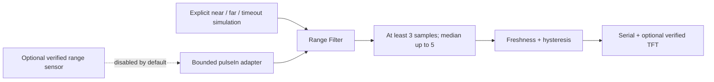

# VOLTRA Echo: architecture and technical deep dive

Turn pulse duration into a readable distance state without treating timeout or stale data as a valid zero. This is a sensor/display experiment, not a validated navigation or collision-avoidance instrument.

## System boundary

Solid arrows show implemented software flow or observed grouping. Dashed arrows identify optional, disabled or unverified paths. Neither is a recovered wiring schematic.

## Source and processing contract

| Layer | Source | Responsibility |
| --- | --- | --- |
| Configuration | [config.h](../firmware/distance_display/config.h) | Unset GPIOs, interface and TFT guards |
| Filter | [distance.h](../firmware/distance_display/distance.h) | Conversion, median and freshness |
| Adapter | [distance_display.ino](../firmware/distance_display/distance_display.ino) | Optional trigger/echo acquisition and output |
| Verification | [test_core.cpp](../tests/test_core.cpp) | Deterministic pulse/filter assertions |

Filter::push(now, pulseUs) uses cm = pulseUs × 0.0343 / 2 for echo round-trip time. The sound-speed constant is approximate, not temperature compensated. Zero pulses or values outside the reference 2–400 cm acceptance window clear the filter. This window is **not a verified sensor specification**.

At least three fresh samples are required. A median over up to five samples suppresses isolated variation. read(now) invalidates at 1000 ms; near-state hysteresis enters below 30 cm and exits at 35 cm. These are presentation policies, not safe clearance guarantees.

The optional path uses a 30,000 µs pulseIn timeout and nominal 200 ms acquisition interval. Serial n/l/f supplies explicitly simulated near/far/timeout input while physical sensing is disabled. No HTTP/wireless API exists. Safe echo voltage and TFT profile require identification.

## Evidence boundary

No actual accuracy, target reliability, motion analysis or safe obstacle-avoidance performance was measured.

[Documentation index](ENGINEERING_STANDARD.md) · [Design decisions](DECISIONS.md) · [Security](../SECURITY.md)
